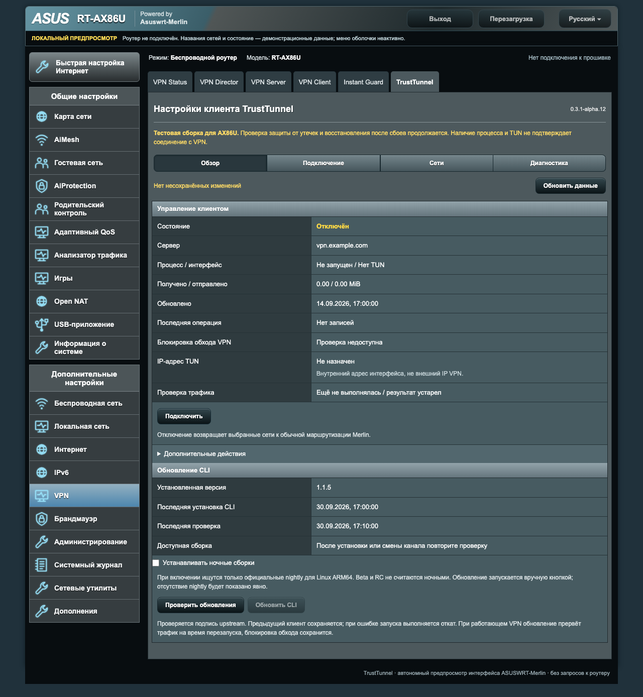
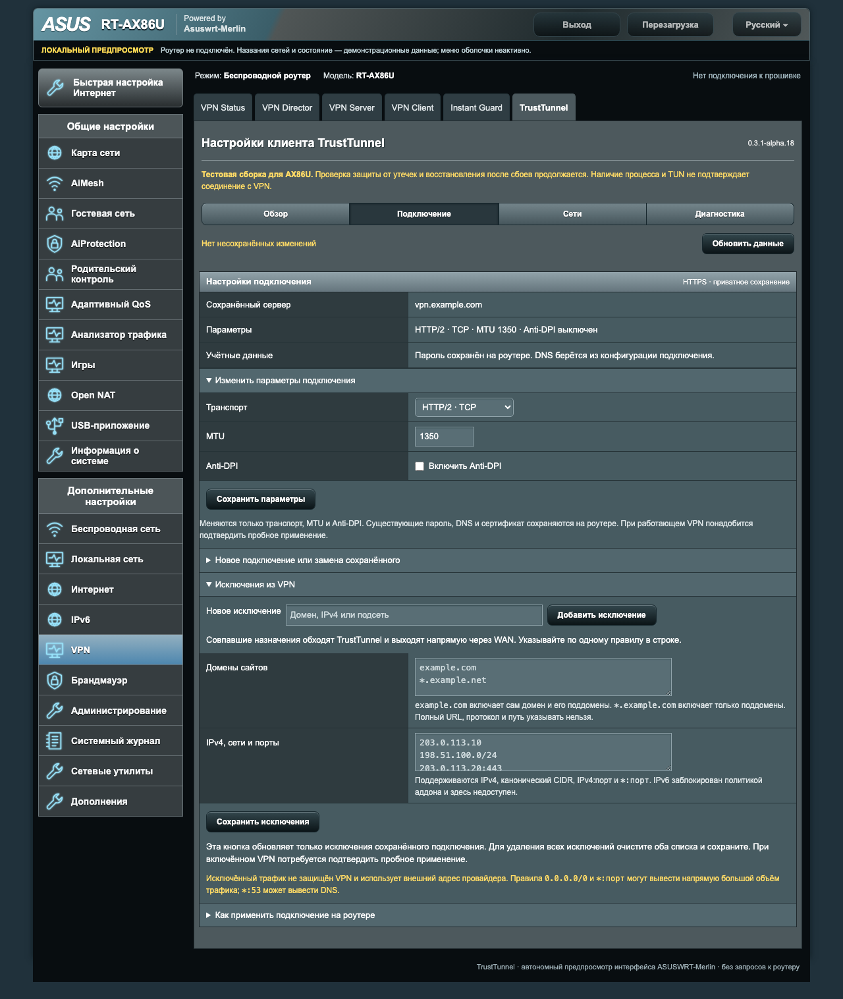
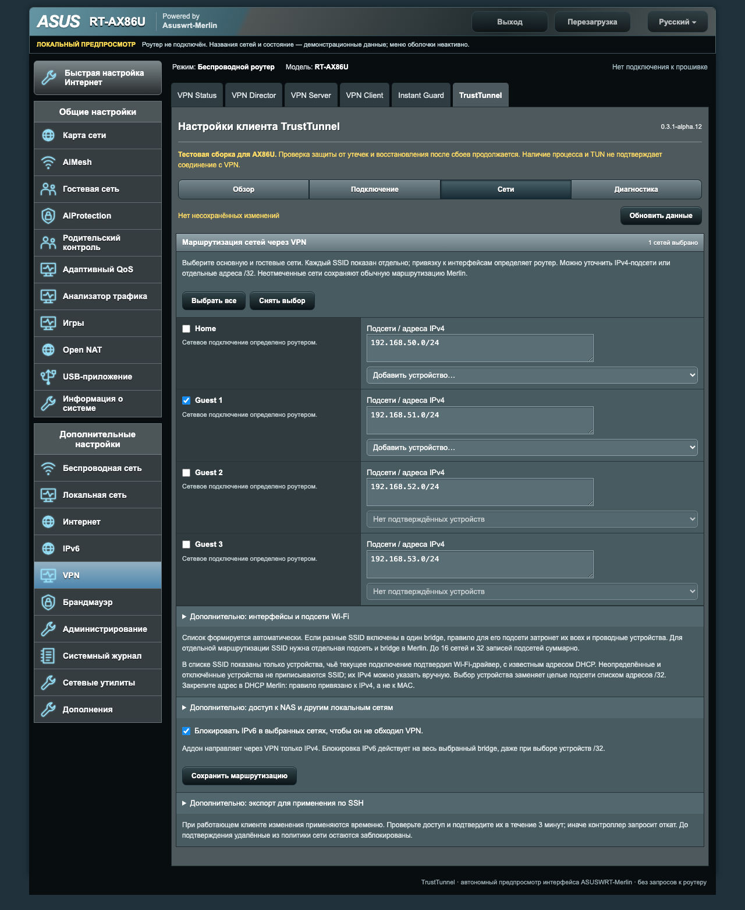

# asuswrt-merlin-trusttunnel

Проект разработан совместно с **OpenAI Codex**: от изучения TrustTunnel и устройства аддонов Merlin до реализации, исправлений и проверок. Решения и тестирование на реальном роутере выполнялись с участием автора проекта.

Нативная веб-панель клиента [TrustTunnel](https://github.com/TrustTunnel/TrustTunnelClient) для ASUSWRT-Merlin. Открывается в **VPN → TrustTunnel**, использует штатный веб-сервер роутера и оформление Merlin.

**Текущий выпуск: 0.3.1-alpha.18.** [Скачать IPK и исходники](https://github.com/VitaliyYakob/asuswrt-merlin-trusttunnel/releases/tag/v0.3.1-alpha.18). Добавлены выбор LAN-портов, время работы клиента и автоматическое наблюдение трафика; исправлены списки устройств SSID и очистка Ethernet-правил. Удалены ручная проверка трафика и её история. Это предварительная версия: полная проверка защиты от утечек и восстановления после сбоев продолжается. [Изменения выпуска](docs/RELEASE-NOTES.md), [фактический отчёт](docs/TEST-REPORT.md), [план испытаний](docs/HARDWARE-TESTS.md).

IPK alpha.18 установлен на RT-AX86U с сохранением CLI 1.1.7 и прежней политики гостевой сети и LAN4. На alpha.16 пользователь подтвердил сайты и внешний IP VPN на LAN4; после последующих обновлений проверены сохранность правил и двусторонние счётчики. Выбор устройства в списке меняет только черновик до сохранения маршрутизации.

## Возможности

- Подключение вручную, ссылкой `tt://` или импортом файла. DNS из подключения сохраняется без подмены.
- Карточка сохранённого подключения. Транспорт, MTU и Anti-DPI изменяются отдельно без повторного ввода пароля; учётные данные и DNS остаются на роутере.
- Выбор всех обнаруженных сетей либо отдельных подсетей и устройств IPv4. SSID показаны раздельно; список устройств содержит только клиентов с подтверждённой принадлежностью этому SSID. Bridge определяется роутером и не редактируется.
- Выбор одного, нескольких или всех доступных LAN-портов RT-AX86U без смены подсети. Поддерживается нетегированный Ethernet; WAN, IPTV и агрегация исключены. Нужен штатный `ebtables` и отсутствие конфликтующих политик маркировки. Проверка реального трафика по физическим портам фиксируется отдельно от автономных тестов.
- Исключения: домены, поддомены, IPv4, CIDR и порты. Их можно изменять без повторного ввода ссылки и пароля. В панели есть краткая справка.
- Одна основная кнопка «Подключить / Отключить». Пауза с сохранением блокировки и перезапуск доступны в дополнительных действиях.
- Пробное применение настроек работающего VPN с подтверждением и возвратом к предыдущим параметрам.
- Обновление официального CLI кнопкой: проверка релизов, отдельный канал nightly, проверка GPG-подписи и резерв предыдущего клиента. Работающий VPN получает пятиминутное испытание с подтверждением или возвратом предыдущей версии. Даты установки и проверки сохраняются.
- Время работы процесса клиента, датированное автоматическое наблюдение пакетов примерно раз в минуту.
- Внутренний IP TUN, счётчики трафика и проверка правил. Процесс и созданный интерфейс сами по себе не считаются подтверждением VPN-соединения.
- Диагностика, показатели CPU/памяти, ограниченный журнал и удаление аддона с очисткой собственных файлов и правил.

Установка сама не запускает VPN и не отключает аппаратное ускорение. Во время работы выбранный VPN-трафик обрабатывается программно; ускорение остальных сетей сохраняется. Не устанавливаются отдельный HTTP-сервис, Docker, Node.js или Python.

## Интерфейс

Снимки получены из настоящего интерфейса на **демонстрационных данных**. Сервер `vpn.example.com`, SSID и устройства вымышлены. Шапка и меню в локальном предпросмотре имитируют Merlin; на роутере их формирует прошивка.



<details><summary>Сохранённое подключение и исключения</summary>



</details>

<details>
<summary>Выбор сетей и устройств</summary>



</details>

## Требования и зависимости

Текущая цель — **ASUS RT-AX86U / ARM64 (aarch64)** с ASUSWRT-Merlin и рабочим [Entware](https://github.com/Entware/Entware/wiki/Install-on-Asus-stock-firmware). Для Entware используется архитектура `aarch64-3.10`.

В **Administration → System** включите *Enable JFFS custom scripts and configs*. Для установки нужен SSH с правами администратора; для настройки — HTTPS-доступ к веб-панели из локальной сети. `/opt` должен быть доступен и поддерживать исполнение файлов. Для первоначального скачивания клиента и зависимостей нужен Интернет, поэтому IPK не является полностью автономным комплектом.

| Компонент | Для чего нужен |
| --- | --- |
| `jq-full`, `flock` | Проверка конфигураций и блокировка параллельных операций. Минимальный `jq` без регулярных выражений не подходит. |
| `curl`, `ca-bundle`, `openssl-util`, `gnupg` | HTTPS-загрузка, доверенные сертификаты, сохранение подключения и проверка подписи CLI. |
| `coreutils-id`, `coreutils-sha256sum`, `coreutils-mktemp`, `coreutils-base64`, `coreutils-od`, `coreutils-stat`, `coreutils-timeout`, `coreutils-mkfifo`, `tar` | Файлы, контрольные суммы, формат бинарника, ограниченные по времени операции и канал ограниченного журнала. |
| Штатные `ip`, `iptables`, `ip6tables`, `ebtables` для LAN-портов, TUN, `nvram`, `cru`, Merlin Addons API | Интерфейс и маршрутизация. Для HND нужны штатные `fc` и `SKIPLOG`; готовность проверяется перед запуском. |

Пакет объявляет зависимости Entware. Установщик по ссылке подготавливает их и безопасно заменяет минимальный `jq`, предварительно сохранив пакеты для восстановления. Общего `opkg upgrade` нет. Существующие общие зависимости не удаляются вместе с аддоном.

## Установка по ссылке

Подключитесь к роутеру по SSH. Если аддон уже работает, сначала нажмите **«Отключить»**, завершите пробное применение/восстановление и только затем обновляйте сам аддон.

```sh
curl -sfL https://raw.githubusercontent.com/VitaliyYakob/asuswrt-merlin-trusttunnel/main/install-online.sh | sh -s -- --lab-only
```

`--lab-only` явно включает установку экспериментальной версии. Скрипт скачивает закреплённый релиз IPK и сверяет встроенный SHA-256 **до распаковки**. Затем устанавливает зависимости и панель. При первой установке скачивается официальный CLI **1.1.5**: проверяются закреплённые хеши архива/бинарника, GPG-подпись и ARM64. Уже установленный собственный CLI с корректным записанным хешем сохраняется; переустановка не понижает его версию.

После сообщения об успешной установке откройте **VPN → TrustTunnel**. Если SSH сообщает об ошибке, установка не считается завершённой; причина и пути резервов указаны в выводе. Дополнительные варианты: [INSTALL.md](docs/INSTALL.md).

## Ручная установка IPK

1. Скачайте из [Releases](https://github.com/VitaliyYakob/asuswrt-merlin-trusttunnel/releases/tag/v0.3.1-alpha.18) пакет `asuswrt-merlin-trusttunnel_0.3.1-alpha.18-1_aarch64-3.10.ipk` и файл `SHA256SUMS` того же релиза.
2. Проверьте SHA-256 пакета и перенесите его на роутер, например в `/tmp`.
3. Подготовьте Entware и установите пакет:

```sh
opkg update
opkg install /tmp/asuswrt-merlin-trusttunnel_0.3.1-alpha.18-1_aarch64-3.10.ipk
```

При наличии конфликтующего минимального `jq` сначала выполните подготовку из [инструкции IPK](docs/INSTALL.md#конфликт-минимального-jq). Не используйте `--force-depends`, `--force-overwrite` или принудительную архитектуру.

Установка IPK оставляет VPN выключенным. Если загрузка клиента или заключительная установка не прошла, устраните указанную причину и выполните `opkg configure asuswrt-merlin-trusttunnel`. Обновление самого аддона выполняется новым IPK после явного отключения; кнопка **«Обновить CLI»** обновляет только клиент.

## Первая настройка

1. В **«Подключении»** введите параметры или разберите `tt://`, затем сохраните подключение. Пароль и полный сохранённый профиль обратно в браузер не возвращаются; сохранённые исключения редактируются отдельно.
2. В **«Сетях»** выберите нужную сеть и сохраните маршрутизацию. Для первого испытания удобно использовать гостевую сеть, оставив основную для управления роутером.
3. Нажмите **«Подключить»**. С устройства выбранной сети проверьте сайты и внешний IP, отключив мобильный Интернет и другие VPN на устройстве.
4. Если меняете настройки при работающем VPN, подтвердите успешное применение в течение указанного в панели срока; иначе контроллер начнёт откат.

Основная кнопка показывает **«Подключить»**, когда процесс клиента остановлен, и **«Отключить»**, когда он запущен. Отключение возвращает выбранный трафик к обычной маршрутизации Merlin и требует подтверждения.

Сохранённое подключение показано отдельной карточкой. Транспорт, Anti-DPI и MTU можно менять через «Изменить параметры подключения»; пароль, DNS и сертификат остаются на роутере. Для другого сервера раскройте «Новое подключение или замена сохранённого».

В **«Дополнительных действиях»** доступны пауза с блокировкой, перезапуск и проверка трафика. После паузы или ошибки запуска нажмите **«Подключить»**, чтобы возобновить VPN с сохранённой защитой. Если требуется вернуть обычный Интернет без VPN, выберите **«Снять блокировку и отключить VPN»** в этом разделе.

## Исключения и сети

В исключениях указываются, например, `example.com`, `*.example.org`, `203.0.113.0/24`, `203.0.113.10:443` или `*:80`. Совпавший трафик выходит напрямую через WAN. Полная ссылка `https://example.com/path` не является доменным исключением: протокол и путь нужно убрать. `*:53` разрешает прямой DNS и требует осознанного выбора. Подробности и ограничения форматов — в [EXCLUSIONS.md](docs/EXCLUSIONS.md).

В каждой сети явно выбирается режим «Вся сеть», «Выбранные устройства» или «Свои подсети / адреса». Смена охвата требует подтверждения; черновики режимов сохраняются до перезагрузки формы.

Разные SSID могут находиться в общей IP-подсети. Они отображаются отдельными строками со своими клиентами, однако выбор общей подсети затрагивает все её SSID и проводные устройства. Выбор устройства `/32` требует постоянного IPv4-адреса, например DHCP reservation в Merlin. Аддон не создаёт новые подсети и не меняет настройки Wi-Fi.

IPv6-туннелирования пока нет. Защита IPv6 действует на выбранный bridge целиком, в том числе при выборе отдельных IPv4-устройств. Это явно указано при сохранении политики. Исключения и правила не являются обещанием полной защиты от утечек: [границы проверок](docs/SECURITY.md).

## Обновление CLI

В **«Обзоре»** нажмите **«Проверить обновления»**, затем **«Обновить CLI»**, если найден подходящий релиз. При установленном флажке **«Устанавливать ночные сборки»** поиск выбирает официальный nightly для Linux ARM64. Beta не подставляется вместо nightly; отсутствие такой сборки показывается явно. Флажок не включает фоновую установку.

При обновлении работающего клиента трафик выбранных сетей прерывается на время перезапуска, блокировка сохраняется. Схема подключения основана на 1.1.5; текущий сценарий подтверждён с 1.1.7, совместимость произвольных будущих версий не гарантируется. [Алгоритм, проверка подписи и восстановление](docs/CLIENT-UPDATES.md).

## Удаление

Сначала посмотрите состав удаления:

```sh
sh /jffs/addons/trusttunnel/uninstall.sh --dry-run
```

Удаление только пакета снимает интеграцию и сохраняет конфигурацию/CLI для переустановки:

```sh
opkg remove asuswrt-merlin-trusttunnel
```

Для полной очистки собственных данных сначала выполните:

```sh
sh /jffs/addons/trusttunnel/uninstall.sh --purge --confirm-release-traffic --confirm-delete-data
# Если устанавливались через IPK, после успешного purge удалите регистрацию пакета:
opkg remove asuswrt-merlin-trusttunnel
```

Удаление возвращает выбранные сети к обычному Интернету. Общие пакеты Entware, чужие hooks и настройки Wi-Fi сохраняются. [Подробности и ограничения очистки](docs/UNINSTALL.md).

## Разработка и источники

[Автономный предпросмотр](preview/index.html) можно открыть на компьютере. Он использует примерные данные и не обращается к роутеру. Инструменты компьютера и проверки описаны в [CONTRIBUTING.md](CONTRIBUTING.md).

```sh
make test
make lint
make browser-test
make screenshots
make package
```

В `dist/` создаются IPK, архивы исходников, `manifest.json` и `SHA256SUMS`. Процесс выпуска GitHub добавляет подписанное свидетельство происхождения `attestation.bundle.json`; [проверка](docs/PUBLISHING.md#свидетельство-происхождения-alpha13) выполняется на компьютере. Клиентские бинарники и настоящие настройки в поставку не включаются.

Основные источники: [TrustTunnelClient](https://github.com/TrustTunnel/TrustTunnelClient), [Merlin Addons API](https://github.com/RMerl/asuswrt-merlin.ng/wiki/Addons-API). При проектировании изучены [AmneziaWG для Merlin](https://github.com/r0otx/asuswrt-merlin-amneziawg), [XrayUI](https://github.com/DanielLavrushin/asuswrt-merlin-xrayui) и [авторская статья об XrayUI](https://habr.com/ru/articles/875148/). Два способа установки и формат IPK организованы по примеру AmneziaWG; реализация TrustTunnel самостоятельная. [Исследование и обоснования](docs/RESEARCH.md), [закреплённые upstream-данные](docs/UPSTREAM.md). Код проекта распространяется по [MIT](LICENSE); официальный CLI поставляется отдельно на условиях upstream.

## Совместимость и тестирование

**Минимальная поддерживаемая прошивка для этой поставки — ASUSWRT-Merlin 3004.388.12.** Установщик отклоняет более старую ветку 3004. Addons API появилась в 384.15, но это само по себе не подтверждает совместимость TrustTunnel, HND и правил аддона. Фактическая самая ранняя совместимая прошивка ещё не установлена; другие модели и ветка 3006 отдельно не испытывались.

Тестирование выполнялось на **ASUS RT-AX86U, прошивка 3004.388.12**, точная проверенная сборка — **3004.388.12_2**, ядро 4.1.52, Entware. Подтверждены работа выбранной гостевой сети, смена внешнего IP, обновление CLI 1.1.5 → 1.1.7, пауза и восстановление, полное удаление alpha.6. На alpha.16 пользователь проверил LAN4 современным устройством и оставил его через VPN. Обновление IPK alpha.17 → alpha.18 сохранило конфигурацию, CLI и правила; после него наблюдался двусторонний трафик. Чистая установка, удаление alpha.18, все физические порты и полная проверка утечек остаются незавершёнными. Подробности — в [TEST-REPORT.md](docs/TEST-REPORT.md).
